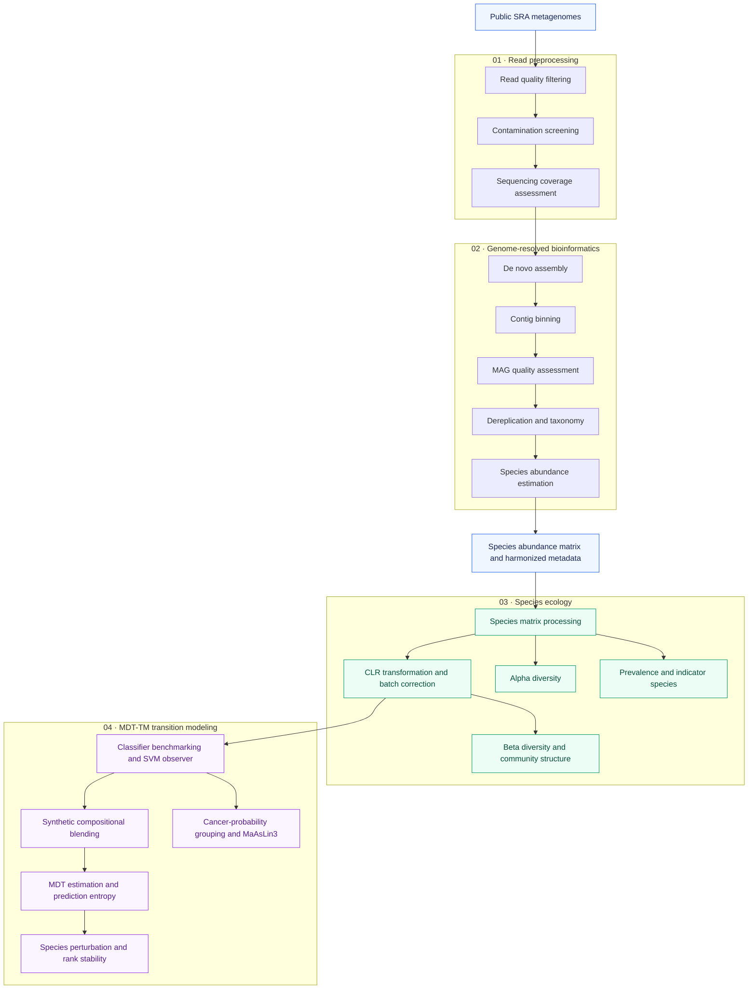

# 🧬 MDT-TM_CRC_Microbiome-Framework

[](https://doi.org/10.5281/zenodo.18760840)

Genome-resolved workflow implementing Minimal Dominance Threshold–Transition Modeling (MDT-TM) to investigate threshold-like changes in predicted microbiome states under simulated compositional perturbations across the colorectal cancer (CRC) continuum. This workflow builds on and extends the GRUMB framework.

This repository contains the full computational workflow used in:

**Ascandari A, Aminu S, Benhida R, Daoud R.**
*Modeling compositional perturbations and predicted state transitions in the colorectal cancer microbiome.*

The study introduces **Minimal Dominance Threshold–Transition Modeling (MDT-TM)**, a genome-resolved computational framework for estimating model-derived dominance thresholds, characterizing prediction uncertainty, and identifying taxa influencing predicted community-state transitions across healthy, adenoma, and carcinoma microbiome profiles.


## Analytical Workflow



*This diagram summarizes the analytical stages. Consult individual scripts and the manuscript Methods for input requirements and the data representation used in each analysis.*

## Repository Structure

```text
MDT-TM_CRC_Microbiome-Framework/
├── 01_Bioninformatics/
├── 02_Preprocessing/
├── 03_species_ecology/
└── 04_Synthetic_blending/
```

Directories and scripts are numbered to indicate the intended execution order. Individual scripts may require outputs from earlier stages.


---

# 01 Bioinformatics

**Genome-resolved metagenomic reconstruction.**

Scripts include:

- 01_run.sh  
- 02_Assembly_Binning.sh  
- 03_collect_files.sh  
- 04_global_drep_taxonomy_abundance.sh  
- 05_global_ARG.sh  
- 06_global_VFDB.sh  
- 07_clean_abundance_files.sh  
- 08_merge_abundances.sh  
- 09_mapping_to_species.sh  

Implements:

- De novo assembly (MEGAHIT)  
- Binning (MetaBAT2)  
- Dereplication (dRep)  
- Taxonomic assignment (GTDB-Tk)  
- Species-level abundance matrix construction  

---

#  02 Preprocessing

**Quality control and harmonization.**

Scripts include:

- 00_gather_script.sh  
- 01_mag_quality_crc_new.py  
- 02_quast_crc.py  
- 03_fastqscreen_crc_mags.py  
- 04_Nonpareil_CRC.R  
- 05_mags_vf_arg_cleanup.py  

Implements:

- MAG quality filtering  
- Assembly quality metrics  
- Host contamination screening  
- Coverage estimation (Nonpareil)  
- Metadata harmonization  

---

# 03 species_ecology

**Baseline ecological characterization.**

Scripts include:

- 01_species_matrix_processing.py  
- 02_CLR_batch_correction_species.R  
- 03_Species_alpha_diversity.R  
- 04_Beta_diversity_species.R  
- 05_Indicator_Specie_Analysis.R  
- 06_Species_Prevalence.R  

Implements:

- CLR transformation and batch correction  
- Alpha diversity (Shannon, Simpson, Richness, Evenness)  
- Beta diversity (Aitchison distance, NMDS, PERMANOVA)  
- Indicator species analysis  
- Core–periphery prevalence architecture  

---

# 04 Synthetic blending

**Minimal Dominance Threshold – Transition Modeling (MDT-TM)**

Scripts include:

- 01_species_benchmark.py
- 02_feature_importance.py
- 03_LOCO_SVM.ipynb
- 04_blending_species.py
- 04_metadata_threshold_mdt.py
- 05_Sensitivity_analysis_MDT_1.ipynb
- 06_Species_stability_MDT_uncertainty.py
- 07_maaslin3_analysis.R

Implements:

- SVM observer model training
- Leave-one-cohort-out validation of the SVM model using CLR batch-corrected and non-batch-corrected matrices
- Synthetic compositional blending between microbiome states
- Minimal Dominance Threshold (MDT) estimation
- Sensitivity analysis of MDT estimates using alternative donor-dominance criteria and blending resolutions
- Shannon prediction entropy and model-derived instability width
- Sensitivity analysis of prediction entropy relative to MDT
- MDT uncertainty and transition-ordering stability across repeated simulations
- Directional species perturbation analysis near MDT
- Species influence-ranking stability across 30 independent simulations
- Cancer-probability-based sample grouping
- Exploratory MaAsLin3 differential abundance and prevalence analyses

---

# Software Requirements

Core tools:

- MEGAHIT  
- MetaBAT2  
- dRep  
- GTDB-Tk  
- CheckM2  
- QUAST  
- BBTools  
- FastQ Screen  
- Nonpareil  
- CoverM  
- R (vegan, limma, indicspecies, MaAsLin3)  
- Python (scikit-learn, pandas, numpy, scipy)  

Exact versions are specified in the manuscript Methods section.

---

# Data Availability

All metagenomic datasets are publicly available from the NCBI Sequence Read Archive (SRA).  
Accession numbers are provided in Supplementary Table 1 of the manuscript.

---

# Citation

If you use this workflow, please cite:
Ascandari A et al.
*Modeling compositional perturbations and predicted state transitions in the colorectal cancer microbiome. (under review).*

*Software archive: Zenodo: https ://doi.org/10.5281/zenodo.18760840*

---

# License

This project is licensed under the MIT License. It is freely available for academic research and other uses in accordance with the license terms.

Please cite the associated publication when reusing or adapting the MDT-TM framework or its scripts.
