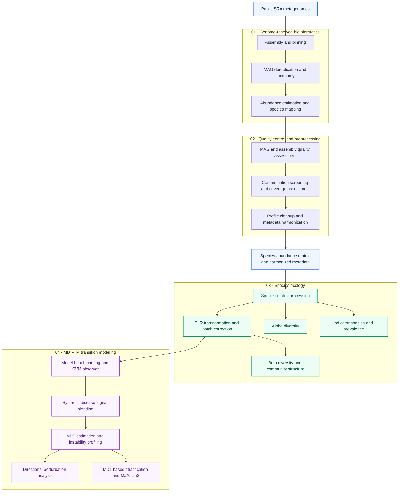

# 🧬 MDT-TM_CRC_Microbiome-Framework

[](https://doi.org/10.5281/zenodo.18760840)

Genome-resolved workflow implementing Minimal Dominance Threshold–Transition Modeling (MDT-TM) to quantify tipping-point dynamics in colorectal cancer microbiome progression. This workflow builds on and extends the GRUMB framework.

This repository contains the full computational workflow used in:

**Ascandari A, Aminu S, Benhida R, Daoud R.**  
*Modeling compositional perturbations and predicted state transitions in the colorectal cancer microbiome.*

The study introduces **Minimal Dominance Threshold – Transition Modeling (MDT-TM)**, a genome-resolved ecological modeling framework that quantifies tipping-point dynamics along the colorectal cancer (CRC) continuum (Healthy → Adenoma → Carcinoma).


## Analytical Workflow



*This diagram summarizes the analytical stages. Consult individual scripts and the manuscript Methods for input requirements and the data representation used in each analysis.*

## Repository Structure

```text
MDT-TM_CRC_Microbiome-Framework/
├── 01_Bioninformatics/
├── 02_Preprocessing/
├── 03_species_ecology/
└── 04_Synthetic_blending/
```

Directories and scripts are numbered to indicate the intended execution order. Individual scripts may require outputs from earlier stages.


---

# 01_Bioinformatics

Genome-resolved metagenomic reconstruction.

Scripts include:

- 01_run.sh  
- 02_Assembly_Binning.sh  
- 03_collect_files.sh  
- 04_global_drep_taxonomy_abundance.sh  
- 05_global_ARG.sh  
- 06_global_VFDB.sh  
- 07_clean_abundance_files.sh  
- 08_merge_abundances.sh  
- 09_mapping_to_species.sh  

Implements:

- De novo assembly (MEGAHIT)  
- Binning (MetaBAT2)  
- Dereplication (dRep)  
- Taxonomic assignment (GTDB-Tk)  
- Species-level abundance matrix construction  

---

#  02_Preprocessing

Quality control and harmonization.

Scripts include:

- 00_gather_script.sh  
- 01_mag_quality_crc_new.py  
- 02_quast_crc.py  
- 03_fastqscreen_crc_mags.py  
- 04_Nonpareil_CRC.R  
- 05_mags_vf_arg_cleanup.py  

Implements:

- MAG quality filtering  
- Assembly quality metrics  
- Host contamination screening  
- Coverage estimation (Nonpareil)  
- Metadata harmonization  

---

# 03_species_ecology

Baseline ecological characterization.

Scripts include:

- 01_species_matrix_processing.py  
- 02_CLR_batch_correction_species.R  
- 03_Species_alpha_diversity.R  
- 04_Beta_diversity_species.R  
- 05_Indicator_Specie_Analysis.R  
- 06_Species_Prevalence.R  

Implements:

- CLR transformation and batch correction  
- Alpha diversity (Shannon, Simpson, Richness, Evenness)  
- Beta diversity (Aitchison distance, NMDS, PERMANOVA)  
- Indicator species analysis  
- Core–periphery prevalence architecture  

---

# 04_Synthetic_blending

Minimal Dominance Threshold – Transition Modeling (MDT-TM)

Scripts include:

- 01_species_benchmark.py  
- 02_feature_importance.py  
- 03_blending_species.py  
- 04_metadata_threshold_mdt.py  
- 05_maaslin3_analysis.R
- LOCO_SVM.ipynb
- Sensitivity_analysis_MDT.ipynb

Implements:

- SVM observer model training
- Leave-one-cohort-out validation of the SVM model using CLR batch-corrected and non-batch-corrected matrix
- Synthetic disease-signal blending  
- Minimal Dominance Threshold (MDT) estimation
- Sensitivity analysis of the MDT threshold stability
- Shannon entropy instability profiling
- Sensitivity analysis of the Shannon entropy instability at different set thresholds
- Directional perturbation analysis  
- MDT-based sample stratification  
- MaAsLin3 differential abundance testing  

---

# Software Requirements

Core tools:

- MEGAHIT  
- MetaBAT2  
- dRep  
- GTDB-Tk  
- CheckM2  
- QUAST  
- BBTools  
- FastQ Screen  
- Nonpareil  
- CoverM  
- R (vegan, limma, indicspecies, MaAsLin3)  
- Python (scikit-learn, pandas, numpy, scipy)  

Exact versions are specified in the manuscript Methods section.

---

# Data Availability

All metagenomic datasets are publicly available from the NCBI Sequence Read Archive (SRA).  
Accession numbers are provided in Supplementary Table 1 of the manuscript.

---

# Citation

If you use this workflow, please cite:
Ascandari A et al.
Modeling compositional perturbations and predicted state transitions in the colorectal cancer microbiome. (under review).

Software archive: Zenodo: https ://doi.org/10.5281/zenodo.18760840

---

# License

Released for academic research use. Please cite appropriately when reusing the framework or scripts.
